# SOCGuard

Inspector continuo de automatizaciones que vive en Windows Server sin Docker. Lee los logs de cada tarea programada, detecta fallos y abre (o actualiza) el incidente correspondiente en ServiceNow, con evidencia del log y deduplicación para no saturar la mesa de ayuda.

Resuelve el problema de saber **qué se cayó y por qué** cuando una automatización deja de correr: antes de esto, el fallo se descubría cuando alguien se quejaba.

## Cómo funciona

<p align="center">
  
</p>

*Fuente editable en [`docs/diagrama-flujo.mmd`](docs/diagrama-flujo.mmd).*

## Características

| Capacidad | Detalle |
|:--|:--|
| **Descubrimiento automático** | Escanea las carpetas de iniciativas y localiza `log`/`logs`, también anidadas. |
| **Lectura incremental** | Guarda el offset y la fecha de modificación: procesa solo los bytes nuevos (~1 s por ciclo). |
| **Rotación y truncado** | Si un log se rota o se vacía, el puntero se reubica sin repetir eventos. |
| **Detección rigurosa** | Palabras clave (`ERROR`, `CRITICAL`, `Traceback`, `Exception`, `Fallo al`, `FAILED`) con exclusión de falsos positivos (`0 errors`, `error_count: 0`). |
| **Motivo y evidencia** | Extrae el motivo corto y hasta 15 líneas de contexto del log. |
| **Deduplicación** | Primer fallo del día → INC nuevo. Reintentos dentro de la ventana → Work Note en el INC existente. |
| **Logs históricos** | En frío descarta logs más antiguos que la ventana para no alertar sobre el pasado. |

## Requisitos

- Python 3.10+
- `python-dotenv` (instalado con `pip install -r requirements.txt`)
- Windows Server con acceso a las carpetas de logs y a la Table API de ServiceNow

## Puesta en marcha

```bash
pip install -r requirements.txt
cp .env.example .env      # o usa las variables de entorno de Windows
python main.py --status   # estado del inspector e iniciativas descubiertas
python main.py --run-once # una pasada manual
python main.py --daemon --interval 300   # modo continuo
```

## Despliegue en el Programador de tareas

`scripts/registrar_tarea_windows.ps1` crea la tarea `SOCGuard_Log_Inspector` (cada 5 min, se reactiva tras reinicio):

```powershell
powershell -ExecutionPolicy Bypass -File .\scripts\registrar_tarea_windows.ps1
Start-ScheduledTask -TaskName "SOCGuard_Log_Inspector"
```

## Configuración

| Variable | Descripción | Valor por defecto |
|:--|:--|:--|
| `INITIATIVES_ROOT` | Carpeta que contiene las iniciativas a inspeccionar | carpeta padre del proyecto |
| `SN_URL` | Instancia de ServiceNow (Table API) | `https://<instancia>.service-now.com/` |
| `SN_USER` / `SN_PASS` | Cuenta de servicio | vacío |
| `SNOW_ASSIGNMENT_GROUP` | Grupo asignado | `grupo-asignacion-soc` |
| `SNOW_ASSIGNED_TO` | Analista asignado | `SOAR` |
| `SN_CATEGORY` / `SN_SUBCATEGORY` | Categorización del INC | `Software` / `Job Failure` |
| `DEDUP_WINDOW_HOURS` | Ventana de deduplicación | `24` |
| `MAX_LOG_AGE_HOURS` | Antigüedad máxima en la primera pasada | `24` |

## Estructura

```
.
├── config.py                    configuración central
├── logger.py                    logging con rotación
├── state_manager.py             offsets y deduplicación
├── log_scanner.py               escáner de logs y patrones
├── servicenow_client.py         Table API (POST INC, PATCH Work Note)
├── inspector.py                 orquestador del ciclo
├── main.py                      CLI
├── scripts/
│   ├── run_socguard.bat
│   └── registrar_tarea_windows.ps1
├── tests/                       validación offline del escáner
└── docs/                        diagrama del flujo
```

## Seguridad

- Las credenciales viven en variables de entorno o en `.env`, nunca en el código.
- El `.env` real no se versiona; solo existe `.env.example`.
- Los logs de las iniciativas se leen, pero nunca se copian al repo.

## Licencia

MIT — ver [`LICENSE`](LICENSE).
